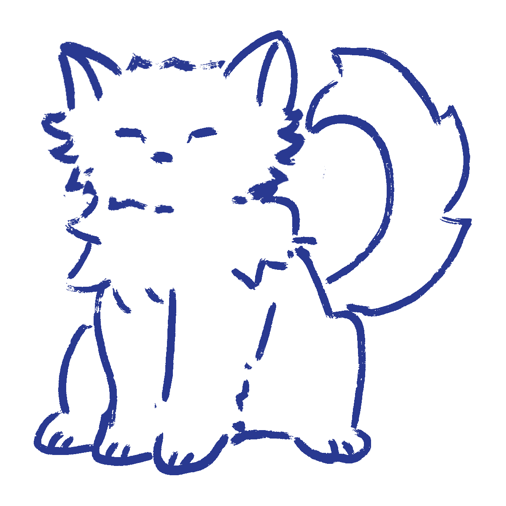
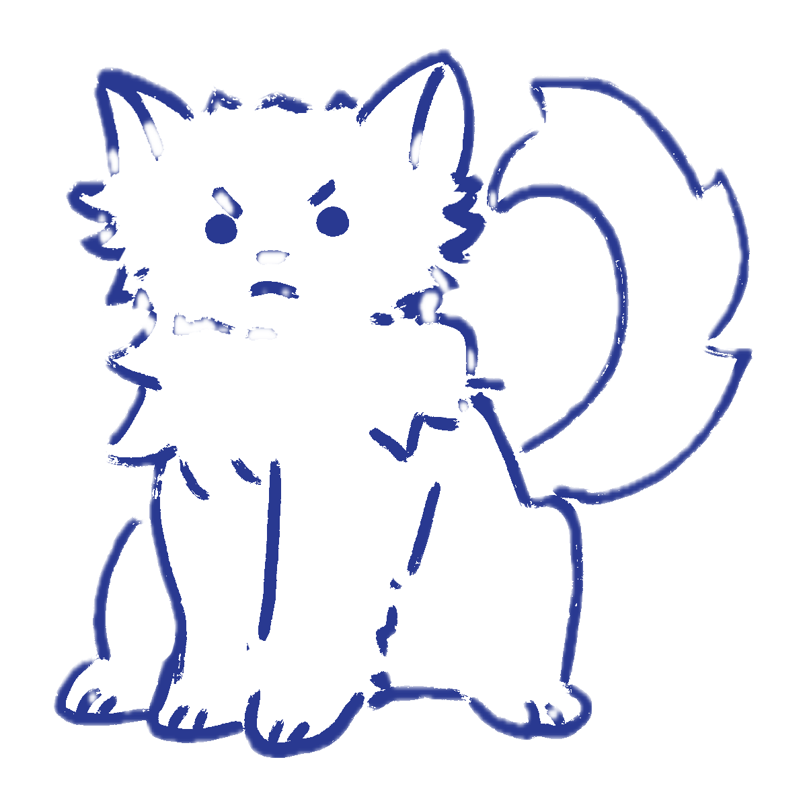
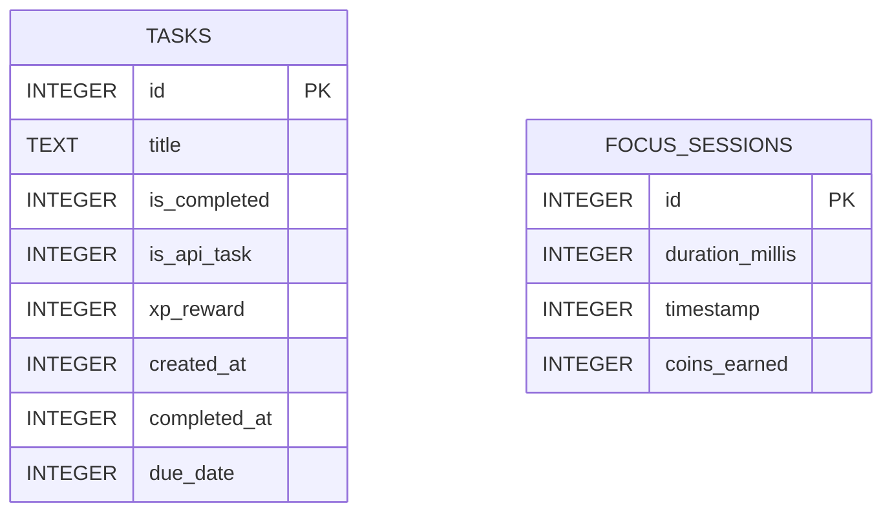
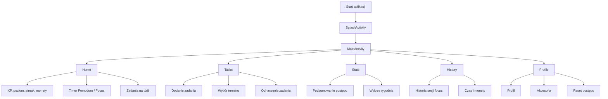
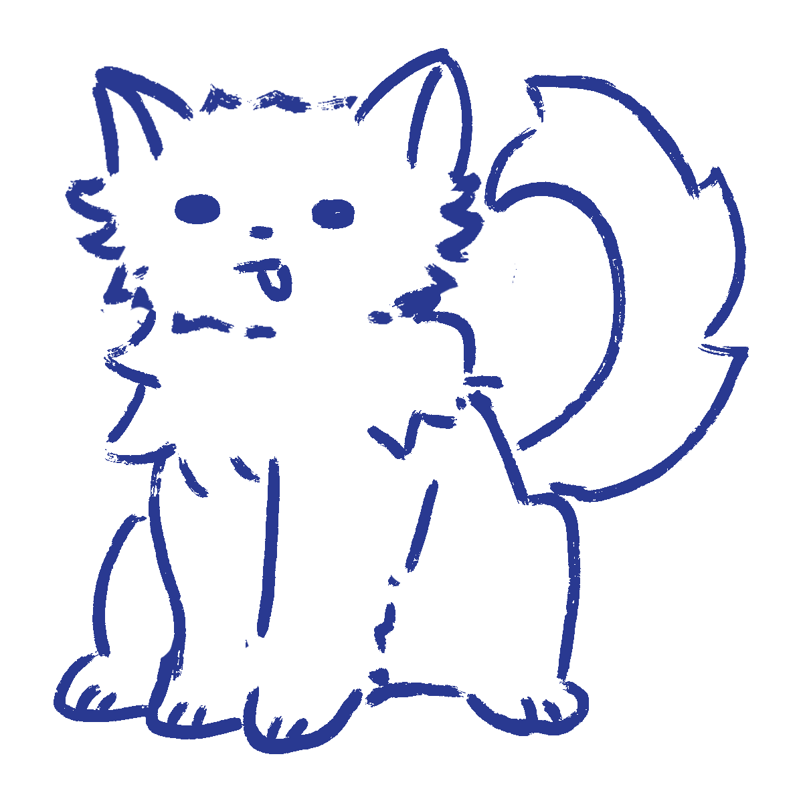

  

  <h1>DailyQuest</h1>

  

    <b>Aplikacja do nauki w stylu techniki Pomodoro i prowadzenia listy zadań to-do.</b>
  

  

    DailyQuest pomaga zapisać zadania, pracować w 25-minutowych sesjach skupienia
    i śledzić swoje postępy w prosty, motywujący sposób.
  

---

## Wygląd aplikacji

DailyQuest ma spokojny, 'graficzny' styl. Interfejs korzysta z kremowego tła, ciemnego tekstu i granatowego koloru jako głównego akcentu. Poniżej są przedstawione główne obrazki i kolory użyte do stworzenia tego projektu.

  #F6F0E4 cream_bg
  #EFE6D7 cream_card
  #243A96 cobalt_blue
  #232323 text_primary
  #77736B gray_text

 

  
  
  
  

## 1. Opis aplikacji

DailyQuest to prosta aplikacja mobilna na Androida, stworzona jako projekt do nauki organizowania pracy. Łączy dwie podstawowe rzeczy:

- technikę typu Pomodoro, czyli pracę w krótkich sesjach skupienia,
- listę zadań to-do, czyli zapisywanie i odhaczanie rzeczy do zrobienia.

Użytkownik może dodawać zadania, ustawić im termin, oznaczać je jako wykonane i zbierać za to punkty XP. Aplikacja ma też 25-minutowy timer focus. Po zakończonej sesji zapisuje czas skupienia oraz przyznaje XP i monety.

Żeby korzystanie było przyjemniejsze, DailyQuest ma elementy grywalizacji: poziomy, serie dni, specjalne zadanie dnia, monety oraz sklep z akcesoriami do profilu.

### Technologie

| Obszar          | Rozwiązanie                               |
| --------------- | ----------------------------------------- |
| Platforma       | Android                                   |
| Język           | Java                                      |
| Baza lokalna    | SQLite przez `SQLiteOpenHelper`           |
| Dane profilu    | `SharedPreferences`                       |
| Zewnętrzne dane | `https://bored-api.appbrewery.com/random` |
| Build           | Gradle Kotlin DSL                         |

---

## 2. Opis podziału pracy

  <b>Kierownik budowy:</b> Emilia Kościelniak

Projekt jest podzielony na kilka prostych części. Każda odpowiada za inny fragment aplikacji.

### Dane

Ta część odpowiada za przechowywanie informacji i pobieranie specjalnego zadania dnia.

| Plik                              | Rola                                                      |
| --------------------------------- | --------------------------------------------------------- |
| `data/model/Task.java`            | Model pojedynczego zadania.                               |
| `data/model/FocusSession.java`    | Model sesji skupienia.                                    |
| `data/local/DatabaseHelper.java`  | Tworzy i obsługuje bazę SQLite.                           |
| `data/local/PrefsManager.java`    | Zapisuje XP, streak, monety, akcesoria i dane profilu.    |
| `data/local/DebugSeedData.java`   | Dodaje dane testowe (aby ułatwić testowanie)              |
| `data/remote/BoredApiClient.java` | Pobiera zadanie dnia z API albo wybiera zadanie awaryjne. |

### Logika aplikacji

Ta część łączy dane z ekranami i pilnuje zasad działania aplikacji.

| Plik                                   | Rola                                                                 |
| -------------------------------------- | -------------------------------------------------------------------- |
| `data/repository/QuestRepository.java` | Główny punkt dostępu do zadań, XP, monet, streaka i historii focus.  |
| `FocusSessionManager.java`             | Zarządza timerem Pomodoro: start, pauza, wznowienie, stop i nagrody. |

### Ekrany

Ta część odpowiada za to, co widzi użytkownik.

| Plik                                    | Ekran                                           |
| --------------------------------------- | ----------------------------------------------- |
| `SplashActivity.java`                   | Ekran startowy.                                 |
| `MainActivity.java`                     | Główny kontener i dolna nawigacja.              |
| `ui/home/HomeFragment.java`             | Ekran główny z timerem, XP i zadaniami na dziś. |
| `ui/tasklist/TaskListFragment.java`     | Lista zadań.                                    |
| `ui/statistics/StatisticsFragment.java` | Statystyki.                                     |
| `ui/history/FocusHistoryFragment.java`  | Historia sesji focus.                           |
| `ui/profile/ProfileFragment.java`       | Profil, monety i sklep z akcesoriami.           |
| `ui/adapter/TaskAdapter.java`           | Wyświetlanie zadań na liście.                   |

---

## 3. Opis i diagram bazy danych

Aplikacja używa lokalnej bazy SQLite `daily_quest.db`. Baza jest bardzo prosta i ma dwie główne tabele:

- `tasks` - zadania z listy to-do oraz specjalne zadania dnia,
- `focus_sessions` - zapisane sesje pracy w skupieniu.

Oprócz SQLite aplikacja używa `SharedPreferences` o nazwie `daily_quest_prefs`. Tam trafia postęp profilu, np. XP, poziom, streak, monety, kupione akcesoria i aktualne zadanie dnia.

### Tabela `tasks`

| Kolumna        | Typ                               | Opis                                 |
| -------------- | --------------------------------- | ------------------------------------ |
| `id`           | INTEGER PRIMARY KEY AUTOINCREMENT | Id zadania.                          |
| `title`        | TEXT                              | Nazwa zadania.                       |
| `is_completed` | INTEGER DEFAULT 0                 | Czy zadanie jest wykonane.           |
| `is_api_task`  | INTEGER DEFAULT 0                 | Czy zadanie pochodzi z zadania dnia. |
| `xp_reward`    | INTEGER DEFAULT 10                | Nagroda XP za wykonanie.             |
| `created_at`   | INTEGER                           | Data utworzenia.                     |
| `completed_at` | INTEGER DEFAULT 0                 | Data wykonania.                      |
| `due_date`     | INTEGER DEFAULT 0                 | Termin zadania.                      |

### Tabela `focus_sessions`

| Kolumna           | Typ                               | Opis                                |
| ----------------- | --------------------------------- | ----------------------------------- |
| `id`              | INTEGER PRIMARY KEY AUTOINCREMENT | Id sesji.                           |
| `duration_millis` | INTEGER                           | Czas trwania sesji w milisekundach. |
| `timestamp`       | INTEGER                           | Data zapisania sesji.               |
| `coins_earned`    | INTEGER                           | Liczba zdobytych monet.             |

### Diagram bazy danych

Tabele nie mają relacji kluczem obcym. Zadania i sesje focus są zapisywane osobno, bo opisują dwa różne typy aktywności użytkownika.

---

## 4. Schemat nawigacji po aplikacji

Po włączeniu aplikacji użytkownik trafia najpierw na ekran startowy, a potem do głównego ekranu z dolną nawigacją.

  

### Dolna nawigacja

| Zakładka | Fragment               | Co można tam zrobić                                            |
| -------- | ---------------------- | -------------------------------------------------------------- |
| Home     | `HomeFragment`         | Sprawdzić postęp, włączyć Pomodoro i zobaczyć zadania na dziś. |
| Tasks    | `TaskListFragment`     | Dodać zadanie, ustawić termin i oznaczyć je jako wykonane.     |
| Stats    | `StatisticsFragment`   | Zobaczyć statystyki XP, zadań i skupienia.                     |
| History  | `FocusHistoryFragment` | Przejrzeć zapisane sesje focus.                                |
| Profile  | `ProfileFragment`      | Sprawdzić profil, monety, akcesoria i zresetować dane.         |

---
## Zrzuty ekranu aplikacji

___

  
  
<b>DailyQuest</b>  Emilia Kościelniak

